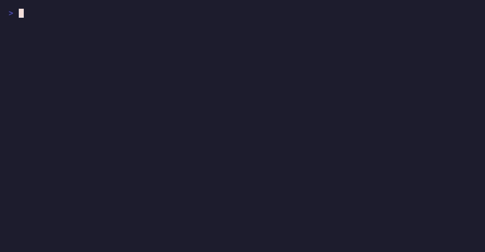

# Sonde

[](https://github.com/srose-io/sonde/actions/workflows/ci.yml)
[](https://www.nuget.org/packages/Sonde)
[](LICENSE)

**Run C# inside a live .NET process.** Resolve its services, read its private state, hook its
methods, tap its SQL and HTTP traffic, and get JSON back. The process never restarts for
debugging after the one start that loads Sonde.



> **The one caveat, up front:** a process must be *started* with Sonde in it. The CLR has no
> attach-time code injection short of a native profiler, so Sonde does not pretend otherwise.
> Start the process once with the probe; after that, never again.

## Sixty seconds

You need the .NET SDK (8, 9 or 10). Nothing else. The demo app is in this repository:

```bash
dotnet tool install -g Sonde.Cli
git clone https://github.com/srose-io/sonde && cd sonde

# Launch your app with the probe inside it (or: eval "$(sonde env --name web)" and launch it however you like).
sonde run --name web -- dotnet run --project samples/MinimalWeb

# From another shell: run C# inside it.
sonde eval web 'return g.Resolve<Microsoft.Extensions.Configuration.IConfiguration>()["Greeting"];'
# "configured hello"

sonde eval web @samples/MinimalWeb/scripts/hook-method.cs
# { "before": 1, "hooked": 1002, "after": 3, "description": "MinimalWeb.CounterService.Increment()" }
```

A script is the body of a method: statements ending in `return x;`. `g` is what it can reach:

```csharp
g.Services              // the host's root IServiceProvider
g.Resolve<T>()          // shorthand
g.Scope()               // a fresh IServiceScope
g.Vars                  // a dictionary that lives across evals: assign now, read later
g.Log("...")            // lines returned with the result
g.Hook<T>("Method", prefix: c => ..., postfix: c => c.Result = ...)   // Harmony patch; g.Unhook / g.UnhookAll
g.Tap("Microsoft.EntityFrameworkCore")   // ring-buffer a DiagnosticListener; g.Tapped(...) reads it
```

The full surface, with examples, is in [docs/script-surface.md](docs/script-surface.md).

## For agents

`Sonde.Mcp` is a stdio [Model Context Protocol](https://modelcontextprotocol.io) server with
four tools (`sonde_list_targets`, `sonde_hello`, `sonde_status`, `sonde_eval`) and a resource
that teaches the script surface:

```bash
dotnet tool install -g Sonde.Mcp
claude mcp add sonde -- sonde-mcp        # Claude Code; any MCP client takes the same command
```

## How it works

```
 sonde / sonde-mcp                                    your process
 ┌────────────────────────┐                          ┌───────────────────────────┐
 │ Sonde (client library) │                          │ Sonde.Probe (startup hook)│
 │   compile with Roslyn ─┼── compiled script ──────▶│   collectible load context│
 │   against what the     │◀── JSON result ──────────┼─  g.Services, g.Hook, ... │
 │   process has loaded   │   local socket / pipe    │   Harmony · DiagnosticListener
 └────────────────────────┘                          └───────────────────────────┘
```

`DOTNET_STARTUP_HOOKS` makes the runtime load `Sonde.Probe.dll` before `Main` (the same
mechanism `dotnet watch` hot reload uses). The probe opens a Unix domain socket (a named pipe on
Windows) and waits. The client compiles your script out of process against the exact assemblies
the target reports, sends the bytes, and the probe runs them in a collectible
`AssemblyLoadContext` and unloads afterwards. Roslyn never enters your process.

**Idle cost**, measured by the end-to-end suite on every CI cell (the Worker sample, a probe
that has answered once and is now waiting): **22 to 28 MB of resident memory and 3 to 5 threads**
across Linux, macOS and Windows on .NET 8, 9 and 10. The number comes from
`artifacts/idle-cost.json`; CI prints it in each job's summary.

[docs/architecture.md](docs/architecture.md) has the whole picture, including what the CLR does
and does not allow and why the design looks like this.

## The packages

| Package | What | Install |
|---|---|---|
| `Sonde.Cli` | The `sonde` command | `dotnet tool install -g Sonde.Cli` |
| `Sonde.Mcp` | The `sonde-mcp` MCP server | `dotnet tool install -g Sonde.Mcp` |
| `Sonde` | The client library: compiler, protocol client, launch helpers, `SondeClient` | `dotnet add package Sonde` |
| `Sonde.Probe` | The in-process agent (the other three ship it; reference it only for `SondeHost.Register`) | `dotnet add package Sonde.Probe` |

Targets: .NET 8, 9 and 10 on Linux, macOS and Windows. CI proves every pair.

## Security

Sonde is remote code execution by design and has no authorisation of its own. The boundary is
the local endpoint: whoever can open the socket can run code in the process, which is the same
set of people who could already attach a debugger to it. Read [docs/threat-model.md](docs/threat-model.md)
before putting a probe in anything you care about, and [SECURITY.md](SECURITY.md) for the
disclosure route.

## Rules the probe lives by

Each of these cost somebody a day once, and each is a named test.

- Never throws in the startup hook. A throw there kills the host before `Main`.
- Scrubs `DOTNET_STARTUP_HOOKS` and `SONDE_ENDPOINT` from its own environment, so no child
  process ever inherits the probe.
- Dormant without `SONDE_ENDPOINT`: no thread, no socket, no cost.
- Passes SDK tooling through (`dotnet.dll`, `dotnet-watch`, MSBuild workers) so the app at the
  bottom of the launch gets the probe, not the ladder.
- Never steals a socket something still answers on.
- One eval at a time, each in its own collectible load context; a runaway script cannot be
  stopped (no `Thread.Abort` on .NET Core), so the probe refuses a second eval until it ends and
  says so.

## Contributing

[CONTRIBUTING.md](CONTRIBUTING.md) has the build, the tests, the layout and what a good pull
request looks like. Design changes are ADRs in [docs/decisions](docs/decisions/0001-charter.md).
MIT licensed.
